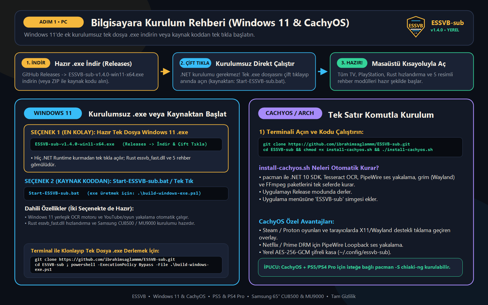
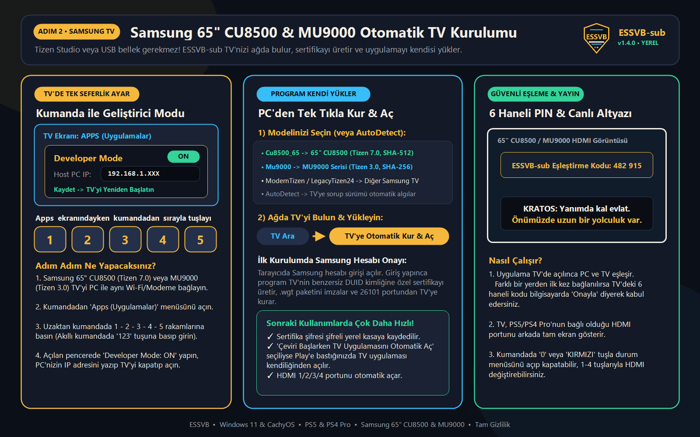
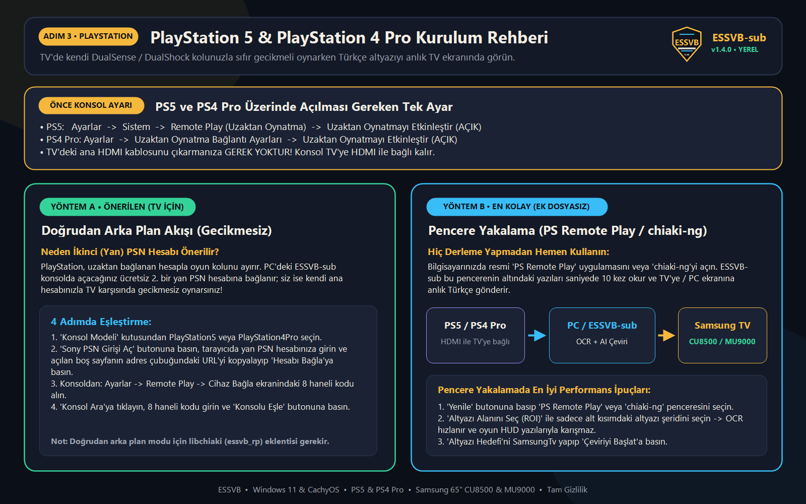
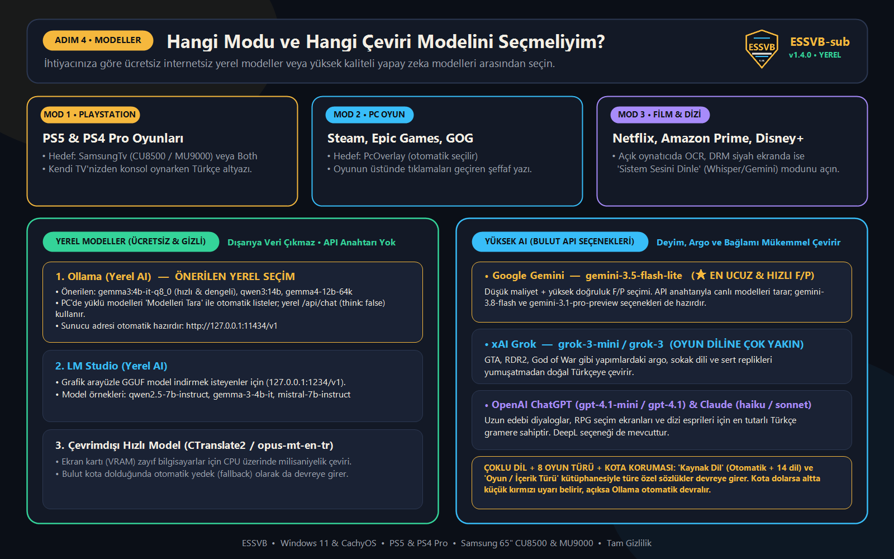
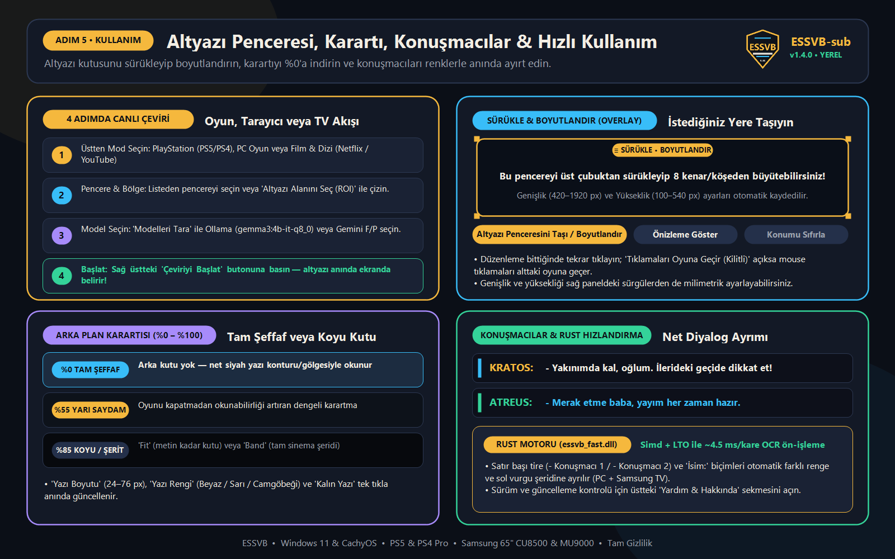

# ESSVB-sub Başlangıç ve Görsel Kurulum Rehberi (`v1.4.0`)

Hiç teknik bilginiz olmasa bile aşağıdaki **5 resimli adımı** sırayla izleyerek **5 dakika içinde** bilgisayarda, **Samsung 65" CU8500 / MU9000 TV**'nizde ve **PlayStation 5 / PS4 Pro** konsolunuzda canlı Türkçe altyazıyı açabilirsiniz. Bu rehberin tamamına uygulamanın üst menüsündeki **`Yardım & Hakkında`** sekmesinden de her zaman ulaşabilirsiniz.

---

## Adım 1: Bilgisayara Kurulum (Windows 11 & CachyOS)



### Windows 11 — Seçenek 1: Hazır Tek Dosya `.exe` (En Kolay, `.NET` Kurulumu Gerekmez!)
1. [GitHub Releases](https://github.com/ibrahimsaglammm/ESSVB-sub/releases/latest) sayfasından **`ESSVB-sub-v1.4.0-win11-x64.exe`** dosyasını indirin.
2. İndirdiğiniz `.exe` dosyasına **çift tıklayın** — harici `.NET SDK/Runtime` kurmanıza gerek kalmadan doğrudan açılır; Rust hızlandırma (`essvb_fast.dll`), 5 rehber görseli ve Samsung TV paketi içine gömülüdür.

### Windows 11 — Seçenek 2: Kaynak Koddan Tek Tıkla Kurulum / `.exe` Üretme
1. Bu GitHub sayfasının sağ üstündeki yeşil **`<> Code`** butonuna tıklayıp **`Download ZIP`** seçin (veya `git clone https://github.com/ibrahimsaglammm/ESSVB-sub.git` komutunu çalıştırın).
2. Klasör içindeki **`Start-ESSVB-sub.bat`** dosyasına çift tıklayın (Masaüstünüze **`ESSVB-sub`** kısayolunu ekler ve açar).
3. İsterseniz yerel `dist\ESSVB-sub-v1.4.0-win11-x64.exe` dosyasını kendiniz üretmek için `powershell -ExecutionPolicy Bypass -File .\build-windows-exe.ps1` komutunu çalıştırabilirsiniz.

### CachyOS / Arch Linux (Tek Satır Kurulum)
```bash
git clone https://github.com/ibrahimsaglammm/ESSVB-sub.git
cd ESSVB-sub
chmod +x install-cachyos.sh
./install-cachyos.sh
```
Bu komut `dotnet-sdk`, `tesseract`, `tesseract-data-eng`, `pipewire-pulse`, `grim` ve `ffmpeg` paketlerini kurup başlatıcıyı uygulama menünüze ekler.

---

## Adım 2: Samsung 65" CU8500 & MU9000 TV Kurulumu



> **Tizen Studio veya USB bellek kurmanıza gerek yoktur.** Program TV'yi ağda kendi bulur, imzalar ve uzaktan TV'ye kurar.

### 1. TV'de Tek Seferlik Geliştirici Modunu Açın
1. Samsung **65" CU8500 (Tizen 7.0)** veya **MU9000 (Tizen 3.0)** TV'nizi bilgisayarınızla **aynı Wi-Fi veya kablo ağına** bağlayın.
2. TV kumandasından **`Apps` (Uygulamalar)** ekranını açın.
3. Kumandadan sırasıyla **`1` `2` `3` `4` `5`** rakamlarına basın (küçük akıllı kumanda kullanıyorsanız önce **`123`** düğmesine basıp ekrandaki sanal tuşlardan `1 2 3 4 5` girin).
4. Açılan küçük pencerede **`Developer Mode`** anahtarını **`ON`** yapın, **`Host PC IP`** kutusuna bilgisayarınızın yerel IP adresini (örneğin `192.168.1.50`) yazın ve **`OK`**'a basıp **TV'yi fişten veya kumandadan tamamen kapatıp tekrar açın**.

### 2. Bilgisayardan Tek Tıkla TV'ye Yükleyin
1. Bilgisayarda **ESSVB-sub** uygulamasını açın.
2. **Samsung Tizen TV** kartında:
   - **`TV Modeli`** alanından `Cu8500_65` (Samsung 65" CU8500), `Mu9000` (Samsung MU9000) veya `AutoDetect` seçin.
   - **`TV Ara`** butonuna basın — program ağdaki Samsung TV'yi otomatik bulup IP adresini doldurur.
   - **`TV'ye Otomatik Kur & Aç`** butonuna tıklayın.
3. İlk kurulumda tarayıcınızda Samsung Hesabı girişi açılır. Giriş yaptığınızda program TV'ye özel sertifikayı şifreli olarak kaydeder, paketi imzalar ve TV'ye yükleyip açar.
4. TV ekranında **`6 Haneli Eşleştirme Kodu`** görünürse bilgisayarınızdaki sarı uyarı bandından **`Onayla`**'ya basın. (Tek seferliktir; sonraki açılışlarda doğrudan bağlanır.)

---

## Adım 3: PlayStation 5 & PlayStation 4 Pro Bağlantısı



**Ön Ayar (Konsolda 1 Kere Yapılır):**
- **PS5:** `Ayarlar` ➔ `Sistem` ➔ `Remote Play (Uzaktan Oynatma)` ➔ **`Uzaktan Oynatmayı Etkinleştir`** seçeneğini açın.
- **PS4 Pro:** `Ayarlar` ➔ `Uzaktan Oynatma Bağlantı Ayarları` ➔ **`Uzaktan Oynatmayı Etkinleştir`** seçeneğini açın.

### En Kolay Başlangıç (Yöntem B — Ek Eklenti Gerektirmez)
1. Konsolunuz her zamanki gibi HDMI kablosuyla TV'ye bağlı kalsın.
2. Bilgisayarda **PS Remote Play** veya Linux'ta **chiaki-ng** açın.
3. ESSVB-sub'da **`PlayStation (PS5 / PS4 Pro)`** sekmesini açın:
   - **`Pencere & Ekran Yakalama`** bölümünden **`Yenile`**'ye basıp `PS Remote Play` penceresini seçin.
   - **`Altyazı Alanını Seç (ROI)`** ile alt kısımdaki altyazı şeridini işaretleyin.
   - **`Altyazı Hedefi`** = `SamsungTv`, **`HDMI Portu`** = konsolun takılı olduğu port seçip **`Çeviriyi Başlat`**'a basın!

### Doğrudan Arka Plan Akışı (Yöntem A — DualSense ile TV'de Oynamak İçin)
Konsola bilgisayar penceresi açmadan doğrudan arka plandan bağlanmak için (`essvb_rp` eklentisi derlenmişse):
1. PS5/PS4 Pro içinde **ikinci (ücretsiz yan)** bir PSN hesabı oluşturun.
2. ESSVB-sub'dan **`Sony PSN Girişi Aç`** ile bu yan hesaba girip yönlendirme linkini yapıştırın.
3. Konsoldan aldığınız **8 haneli Remote Play kodunu** girip **`Konsolu Eşle`**'ye tıklayın. Artık siz kendi kolunuzla ana hesabınızda gecikmesiz oynarken bilgisayar arka plandan altyazıyı okur ve TV'ye gönderir.

---

## Adım 4: Hangi Modu ve Çeviri Modelini Seçmeliyim?



### Hangi Çeviri Motoru Bana Uygun?
- **Hiç internet/ücret olmadan kendi PC'mde çalışsın diyorsanız:**
  - **Ollama (Yerel AI):** Program açılışta bilgisayarınızdaki yüklü Ollama modellerini otomatik tarayıp açılır listeye doldurur (`Modelleri Tara` ile istediğiniz zaman yenileyebilirsiniz; **`gemma3:4b-it-q8_0`** hız/kalite dengesi için önerilir ve yerel `/api/chat` + `think: false` ile çalışır). İsterseniz **`Özel model adını elle gir`** kutusunu açıp farklı ad da yazabilirsiniz.
  - **LM Studio:** Grafik arayüzle indirdiğiniz GGUF modellerini de otomatik listeler.
  - **CTranslate2 (`opus-mt-en-tr`):** Ekran kartı belleği düşük sistemler için çok hızlı çevrimdışı çeviri.
- **En doğal deyim, argo, küfür ve hikaye kalitesini istiyorsanız:**
  - **Google Gemini:** Varsayılan **`gemini-3.5-flash-lite` (★ En Ucuz & Hızlı F/P)** ile en düşük maliyetli canlı çeviriyi alabilir; `gemini-3.8-flash` veya `gemini-3.1-pro-preview` modellerini seçebilirsiniz.
  - **xAI Grok, OpenAI ChatGPT, Anthropic Claude, DeepL:** Her sağlayıcı için güncel F/P modeller seçiciden tek tıkla seçilir; API anahtarınızı girdiğinizde hesabınıza açık canlı modelleri de tarayıp listeye ekler.

---

## Adım 5: Altyazı Penceresi, Karartı, Konuşmacı Renkleri & Sürüm Kontrolü



- **Taşı & Boyutlandır:** **`Altyazı Penceresini Taşı / Boyutlandır`** butonuna basın, kutuyu sürükleyip 8 kenar/köşeden büyütüp küçültün; işiniz bitince aynı butona tekrar basın. Konumunuz otomatik kaydedilir.
- **Arka Plan Karartısı (`%0` – `%100`):** Sürgüyü `%0`'a çektiğinizde arka plan karartısı tamamen kalkar ve yazı okunaklı dış kontur/gölge ile görünür.
- **Konuşmacı Renk Ayrımı:** Farklı karakterler (`KRATOS:`, `ATREUS:`) veya `- Satır 1` / `- Satır 2` diyalogları hem PC overlay'inde hem Samsung TV'de farklı renk ve sol vurgu şeridiyle ayrılır.
- **Sürüm & Kurulum Doğrulama:** Üst menüdeki **`Yardım & Hakkında`** sekmesinden kurulu sürümü (`v1.4.0`), Rust motoru (`essvb_fast.dll`) durumunu ve kurulu klasör yolunu istediğiniz an kontrol edebilirsiniz.
- **Çoklu Dil, Alt Şerit Filtresi & Oyun Türü Kütüphaneleri:** Sağ paneldeki **`Kaynak Dil`** (`Otomatik Algıla` dahil 15 dil) ve **`Oyun / İçerik Türü`** seçicileriyle oyununuzun diline ve türüne özel sözlük + üslup anında devreye girer; sol paneldeki **`Sadece Alt Şeridi Yakala`** kutucuğu ise kenardaki HUD yazılarını otomatik yoksayar. Kota/bağlantı sorununda alt kısımda küçük **kırmızı uyarı bandı** belirir ve açıksa yerel Ollama yedeği devralır.

---

## Sık Sorulan Sorular (Hızlı Çözüm)

- **Firefox / YouTube / Chrome üzerinde altyazı yakalanmıyor:**
  - Videoda alt yazının göründüğü alanı **`Altyazı Alanını Seç (ROI)`** ile seçtiğinizde program seçili bölgeyi doğrudan tarar; pencere yakalamaya dönmek için **`Bölgeyi Sıfırla`** butonunu kullanın.
  - **Film & Dizi** sekmesinde TV bağlı değilse çıkış hedefinin `PcOverlay` olduğundan emin olun.

- **Samsung TV bulunamıyor / kurulum bağlanamıyor:**
  - TV ve PC aynı modem/Wi-Fi üzerinde mi?
  - `Apps` ekranında `1 2 3 4 5` yapıp `Host PC IP` kısmına **bilgisayarınızın güncel IP adresini** yazdıktan sonra TV'yi fişten/kumandadan yeniden başlattınız mı?
- **Netflix / Amazon Prime / Disney+ izlerken görüntü siyah oluyor:**
  - Tarayıcı ve uygulamalar DRM (HDCP/Widevine) koruması yüzünden ekran yakalamayı karartabilir. Bu durumda **`Film & Dizi`** sekmesinde **`DRM Korumalı Video İçin Sistem Sesini Dinle`** kutucuğunu işaretleyin — görüntü yerine doğrudan sistem sesini çözüp canlı Türkçe altyazı üretir.
- **Bilgisayarımda Steam / Epic oynarken altyazı tıklamaları engelliyor mu?**
  - Hayır. **`Tıklamaları Oyuna Geçir (Kilitli)`** seçeneği açıksa altyazı katmanı farenizi ve tıklamalarınızı tamamen alttaki oyuna geçirir.
