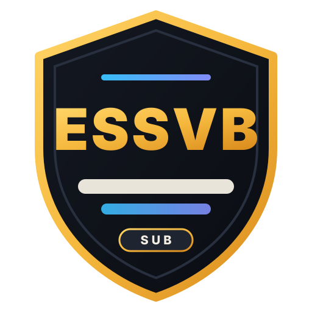
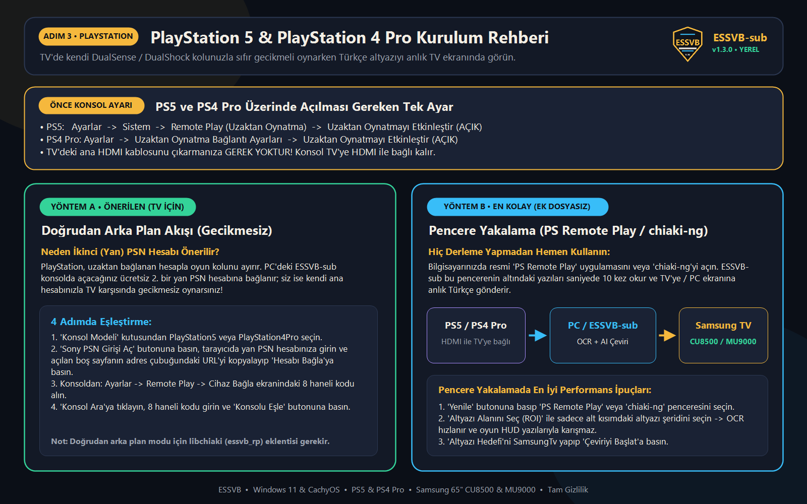
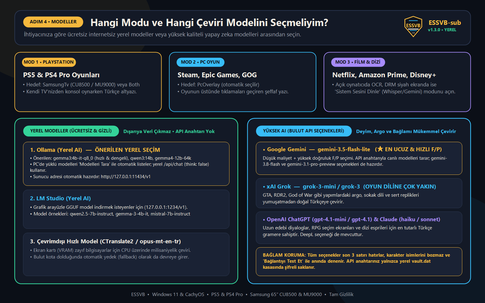
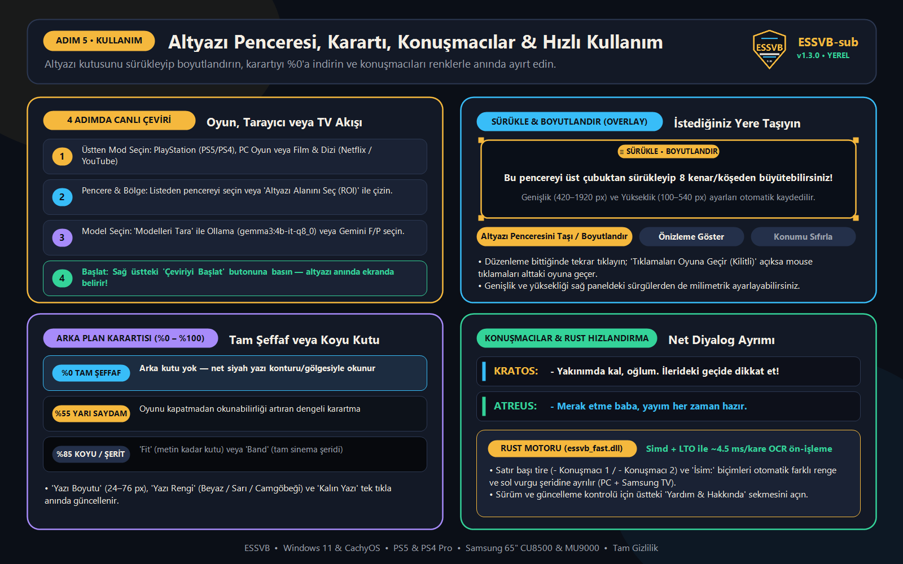

# ESSVB-sub

**ESSVB-sub**, **Windows 11** ve **CachyOS (Arch Linux)** üzerinde çalışan; **PlayStation 5**, **PlayStation 4 Pro**, **PC Oyunları (Steam, Epic Games, GOG)** ve **Film/Dizi platformları (Netflix, Amazon Prime, Disney+)** için geliştirilmiş, **%100 yerel ve gizlilik odaklı** canlı Türkçe altyazı ve yapay zeka çeviri stüdyosudur.

<p align="center">
  
</p>

- **Marka & Lisans:** ESSVB Özel Mülkiyet Lisansı ([LICENSE](LICENSE))
- **Güncel Sürüm:** `v1.3.0` (Windows 11 kurulumsuz tek dosya `.exe` + uygulama içi **`Yardım & Hakkında`** sekmesi + 5 adımlı görsel rehber)
- **Sıfır Telemetri:** Hiçbir dış analiz, izleme, reklam veya ortak veri havuzuna görüntü/metin gönderilmez.
- **Güvenli Yerel TV Yayını:** Yalnızca 6 haneli tek kullanımlık PIN eşleştirmesiyle üretilen şifreli token ile bağlanılır; CGNAT alt ağları engellenir.
- **Ayrıntılı Resimli Anlatım:** Yeni başlayanlar için adım adım rehber ➔ **[KURULUM_REHBERI.md](KURULUM_REHBERI.md)**

---

## GitHub'dan Tek Tıkla Kurulum

### Windows 11 İçin Hazır Tek Dosya `.exe` (En Kolay — `.NET` Kurulumu Gerekmez!)
1. [GitHub Releases](https://github.com/ibrahimsaglammm/ESSVB-sub/releases/latest) sayfasından **`ESSVB-sub-v1.3.0-win11-x64.exe`** dosyasını indirin.
2. Çift tıklayıp doğrudan çalıştırın — `.NET 10`, Rust `essvb_fast.dll`, 5 adımlı rehber ve `tv-tizen/` modülleri tek `.exe` içindedir!
   - İsteğe bağlı SHA-256 doğrulama: aynı sayfadaki `.exe.sha256` dosyası veya `Get-FileHash ESSVB-sub-v1.3.0-win11-x64.exe` ile doğrulayabilirsiniz.

### Kaynak Koddan Kurulum & Tek Dosya `.exe` Derleme (Windows 11)
1. **`Code -> Download ZIP`** ile indirin veya klonlayın:
   ```powershell
   git clone https://github.com/ibrahimsaglammm/ESSVB-sub.git
   ```
2. Hemen açmak için **`Start-ESSVB-sub.bat`** dosyasına çift tıklayın (veya kendi tek dosya `.exe` paketinizi derlemek için):
   ```powershell
   powershell -ExecutionPolicy Bypass -File .\build-windows-exe.ps1
   ```
   - `build-windows-exe.ps1` yerel Rust + .NET Self-Contained `.exe` çıktısını `dist\ESSVB-sub-v1.3.0-win11-x64.exe` yoluna üretir ve `--self-check` ile doğrular.

### CachyOS (Arch Linux)
```bash
git clone https://github.com/ibrahimsaglammm/ESSVB-sub.git
cd ESSVB-sub
chmod +x install-cachyos.sh
./install-cachyos.sh
```


---

## Çalışma Modları ve Görsel Rehberler

### 1. Samsung 65" CU8500 & MU9000 Otomatik TV Kurulumu (`Tizen Studio` Gerekmez)
- **Desteklenen Modeller:** **Samsung 65" CU8500 (Tizen 7.0 — SHA-512)**, **Samsung MU9000 (Tizen 3.0 — SHA-256)** ve Tizen `2.4+` tüm Samsung Smart TV'ler.
- Program yerel ağdaki TV'yi **`TV Ara`** ile kendisi bulur, `tv-tizen/` uygulamasını modele göre imzalayıp **`TV'ye Otomatik Kur & Aç`** ile doğrudan kurar ve TV HDMI görüntüsü üzerine Türkçe altyazı basar.
- Tek ön koşul: TV kumandasından *Apps* ekranında `1 2 3 4 5` ile *Developer Mode*'u açıp PC IP adresini girmektir.


### 2. PlayStation 5 & PlayStation 4 Pro Modu
- **Doğrudan Arka Plan Akışı (`libchiaki` / `essvb_rp`):** İkinci PSN hesabıyla konsola arka plandan bağlanır; TV'de kendi kolunuzla gecikmesiz oynarken altyazıyı TV ekranında görürsünüz.
- **Pencere Yakalama (Ek Kurulumsuz):** Bilgisayardaki `PS Remote Play` veya `chiaki-ng` penceresini okuyup altyazıyı TV'ye veya PC'ye yansıtır.



### 3. PC Oyun Modu & Film/Dizi Modu + Özelleştirilebilir Overlay & Rust Hızlandırma
- **PC Oyun Modu (Steam, Epic Games, GOG):** Fareyle **sürüklenip köşelerden boyutlandırılabilen**, **`%0` (tam karartısız + siyah dış konturlu) – `%100`** karartı ayarlı, farklı konuşmacıları otomatik ayıran renkli şeffaf PC monitör overlay'i.
- **Film & Dizi Modu (Netflix, Amazon Prime, Disney+, YouTube):** Açık pencerede DPI-uyumlu OCR; DRM korumalı siyah ekranda **WASAPI / PipeWire Loopback** sistem sesi dinleme (`whisper-cli` veya `gemini-3.5-flash-lite` Audio).
- **Rust Yerel Hızlandırma (`native/essvb_fast`):** Görüntü ölçekleme, kontrast normalizasyonu (`AutoLevel`), integral gölge metin ayrıştırma (`ShadowText`) ve algısal değişim imzası çekirdekleri native Rust (`cdylib`) ile çalışır (`cargo` yoksa otomatik C# yedeği devreye girer).
- **Yerel & Yüksek AI Seçenekleri (Fiyat/Performans & Otomatik Tarama):**
  - **Yerel:** **Ollama** (yerel `/api/chat` + `think: false` hızlandırmalı, yüklü tüm modelleri otomatik tarayıp listeden seçtiren destek — önerilen `gemma3:4b-it-q8_0`), **LM Studio**, **CTranslate2 (`opus-mt-en-tr`)**
  - **Bulut Yüksek AI:** **Google Gemini** (`gemini-3.5-flash-lite` ★ F/P önerilen, `gemini-3.8-flash`, `gemini-3.1-pro-preview`), **xAI Grok** (`grok-3-mini`), **OpenAI ChatGPT** (`gpt-4.1-mini`), **Anthropic Claude** (`claude-3-5-haiku-latest`), **DeepL** — güncel F/P etiketli seçici + API anahtarıyla canlı model tarama.



### 4. Altyazı Penceresi, Karartı, Konuşmacı Renkleri & Uygulama İçi Resimli Yardım
- **Sürükle & Boyutlandır Overlay:** **`Altyazı Penceresini Taşı / Boyutlandır`** butonuyla kutuyu istediğiniz yere sürükleyip 8 kenar/köşeden yeniden boyutlandırabilirsiniz.
- **%0 Tam Şeffaf – %100 Karartı:** Arka plan karartısı `%0` iken karanlık kutu tamamen kalkar; okunaklı dış konturlu metin görünür.
- **Konuşmacı Renk Ayrımı:** Farklı konuşmacılar ve `- Satır 1 / - Satır 2` diyalogları otomatik renk ve sol vurgu şeridiyle ayrılır.
- **Uygulama İçi `Yardım & Hakkında` Sekmesi:** Program sürümünü (`v1.3.0` + commit doğrulama), Rust hızlandırma durumunu ve bu 5 resimli rehberi doğrudan uygulamanın içinden görüntüleyebilirsiniz.



---

## Geliştirici Komutları & Test

```bash
dotnet restore ESSVB-sub.slnx
dotnet build ESSVB-sub.slnx -c Release --no-restore
dotnet test ESSVB-sub.slnx
```

### İsteğe Bağlı Yerel PlayStation C Kütüphanesi (`essvb_rp`)
```bash
cmake -S native -B build/native -G Ninja -DCHIAKI_SOURCE_DIR=/path/to/chiaki-ng
cmake --build build/native
```
