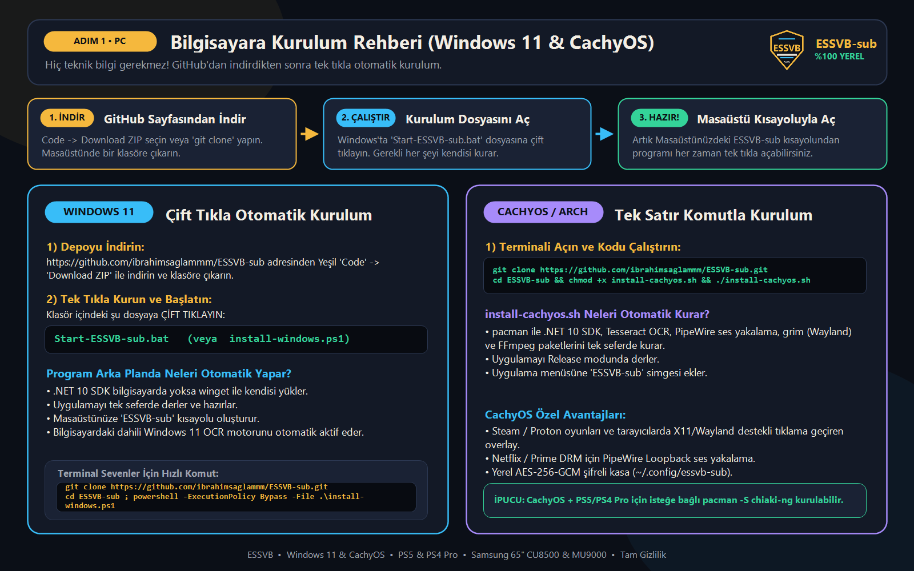
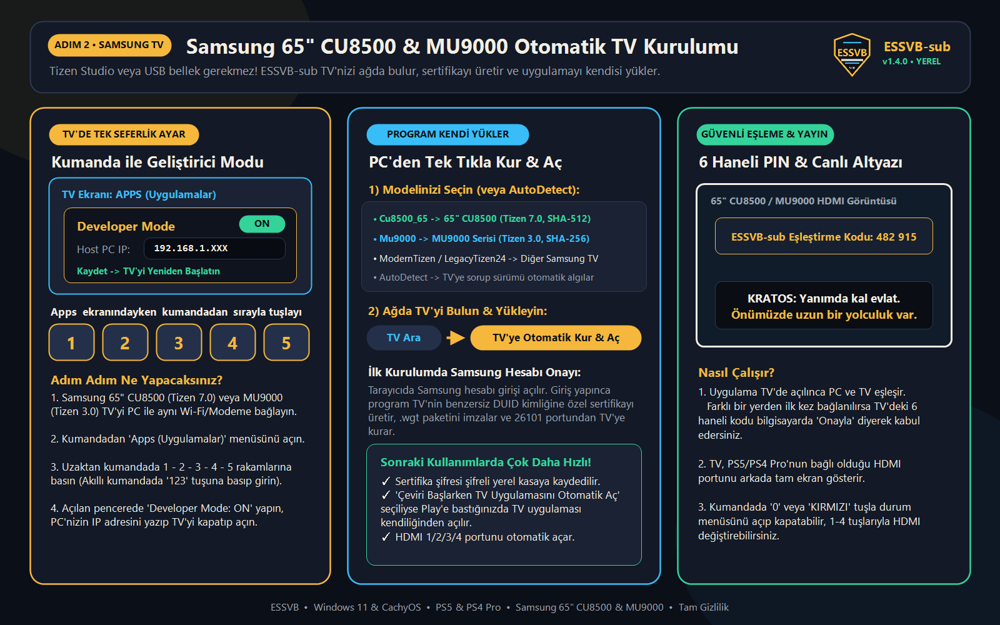

# ESSVB-sub

**ESSVB-sub**, **Windows 11** ve **CachyOS (Arch Linux)** üzerinde çalışan; **PlayStation 5**, **PlayStation 4 Pro**, **PC Oyunları (Steam, Epic Games, GOG)** ve **Film/Dizi platformları (Netflix, Amazon Prime, Disney+)** için geliştirilmiş, **%100 yerel ve gizlilik odaklı** canlı Türkçe altyazı ve yapay zeka çeviri stüdyosudur.

<p align="center">
  
</p>

- **Marka & Lisans:** ESSVB Özel Mülkiyet Lisansı ([LICENSE](LICENSE))
- **Sıfır Telemetri:** Hiçbir dış analiz, izleme, reklam veya ortak veri havuzuna görüntü/metin gönderilmez.
- **Güvenli Yerel TV Yayını:** Yalnızca 6 haneli tek kullanımlık PIN eşleştirmesiyle üretilen şifreli token ile bağlanılır; CGNAT alt ağları engellenir.
- **Ayrıntılı Resimli Anlatım:** Yeni başlayanlar için adım adım rehber ➔ **[KURULUM_REHBERI.md](KURULUM_REHBERI.md)**

---

## GitHub'dan Tek Tıkla Kurulum

### Windows 11
1. **`Code -> Download ZIP`** ile indirin veya klonlayın:
   ```powershell
   git clone https://github.com/ibrahimsaglammm/ESSVB-sub.git
   ```
2. Klasör içindeki **`Start-ESSVB-sub.bat`** dosyasına çift tıklayın (veya `powershell -ExecutionPolicy Bypass -File .\install-windows.ps1`).
   - `.NET 10 SDK` eksikse otomatik yükler, projeyi Release modunda derler, Masaüstünüze **`ESSVB-sub`** kısayolu oluşturur ve programı açar.

### CachyOS (Arch Linux)
```bash
git clone https://github.com/ibrahimsaglammm/ESSVB-sub.git
cd ESSVB-sub
chmod +x install-cachyos.sh
./install-cachyos.sh
```



---

## Çalışma Modları ve Görsel Rehberler

### 1. Samsung 65" CU8500 & MU9000 Otomatik TV Kurulumu (`Tizen Studio` Gerekmez)
- **Desteklenen Modeller:** **Samsung 65" CU8500 (Tizen 7.0 — SHA-512)**, **Samsung MU9000 (Tizen 3.0 — SHA-256)** ve Tizen `2.4+` tüm Samsung Smart TV'ler.
- Program yerel ağdaki TV'yi **`TV Ara`** ile kendisi bulur, `tv-tizen/` uygulamasını modele göre imzalayıp **`TV'ye Otomatik Kur & Aç`** ile doğrudan kurar ve TV HDMI görüntüsü üzerine Türkçe altyazı basar.
- Tek ön koşul: TV kumandasından *Apps* ekranında `1 2 3 4 5` ile *Developer Mode*'u açıp PC IP adresini girmektir.



### 2. PlayStation 5 & PlayStation 4 Pro Modu
- **Doğrudan Arka Plan Akışı (`libchiaki` / `essvb_rp`):** İkinci PSN hesabıyla konsola arka plandan bağlanır; TV'de kendi kolunuzla gecikmesiz oynarken altyazıyı TV ekranında görürsünüz.
- **Pencere Yakalama (Ek Kurulumsuz):** Bilgisayardaki `PS Remote Play` veya `chiaki-ng` penceresini okuyup altyazıyı TV'ye veya PC'ye yansıtır.


### 3. PC Oyun Modu & Film/Dizi Modu + Çeviri Modelleri
- **PC Oyun Modu (Steam, Epic Games, GOG):** Tıklamaları oyuna geçiren (`WS_EX_NOACTIVATE` / `WS_EX_TRANSPARENT` & X11 `XShape`) şeffaf PC monitör overlay'i.
- **Film & Dizi Modu (Netflix, Amazon Prime, Disney+):** Açık pencerede OCR; DRM korumalı siyah ekranda **WASAPI / PipeWire Loopback** sistem sesi dinleme (`whisper-cli` veya Gemini Multimodal Audio).
- **Yerel & Yüksek AI Seçenekleri (Otomatik Model Tarama & Seçici):**
  - **Yerel:** **Ollama** (yerel `/api/chat` + `think: false` hızlandırmalı, yüklü tüm modelleri otomatik tarayıp listeden seçtiren destek), **LM Studio**, **CTranslate2 (`opus-mt-en-tr`)**
  - **Bulut Yüksek AI:** **Google Gemini**, **xAI Grok**, **OpenAI ChatGPT**, **Anthropic Claude**, **DeepL** — güncel model listesi seçicisi ve API anahtarıyla canlı model tarama + isteğe bağlı elle model adı girme sekmesi.


---

## Geliştirici Komutları & Test

```bash
dotnet restore ESSVB-sub.slnx
dotnet build ESSVB-sub.slnx -c Release --no-restore
dotnet test ESSVB-sub.slnx
```

### İsteğe Bağlı Yerel PlayStation C Kütüphanesi (`essvb_rp`)
```bash
cmake -S native -B build/native -G Ninja -DCHIAKI_SOURCE_DIR=/path/to/chiaki-ng
cmake --build build/native
```
